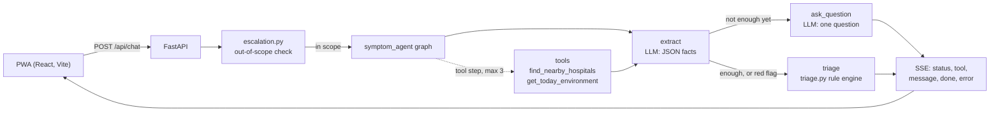

# Architecture

How the app works, from the browser to the rule engine and back. Read this
before you change the chat agent, the safety logic, or the data flow.

Companion docs: [AGENTS.md](../AGENTS.md) (rules for agents),
[API_CONTRACT.md](API_CONTRACT.md) (endpoints), and
[DEPLOY.md](DEPLOY.md) (running it in production).

## Summary

The app is a phone-first PWA backed by one FastAPI service. A chat turn runs a
small LangGraph agent. The language model talks to the user and extracts
structured facts. A deterministic rule engine decides the urgency level. The
model never picks the level.

## Request flow

Step by step:

1. The PWA posts the user's message to `POST /api/chat`
   (`backend/app/api/chat.py`). The route needs a valid bearer token and the
   sensitive-data consent.
2. `escalation.assess` checks the message first. Out-of-scope requests get a
   fixed refusal and never reach the model.
3. `symptom_agent.run_turn` runs the graph (see below) with the saved state of
   the conversation.
4. The graph streams progress into a queue. The route turns queue items into
   SSE frames: `status`, `tool`, `message` (word-sized `delta` chunks),
   `done` (the complete authoritative reply plus the extraction and verdict),
   and `error`.
5. The client appends each `delta`, then replaces the turn with `done`. A
   client that misses a frame still gets the full answer from `done`.
6. The route saves the messages, the `symptom_events` row, and the
   `triage_results` row. Each triage row stores its `rule_version`.

Nginx turns off proxy buffering for `/api/`, and Caddy sets
`flush_interval -1`. Without both, SSE arrives in one lump at the end.

## The safety split (ADR 0001)

Source: [docs/adr/0001-llm-does-not-decide-safety.md](adr/0001-llm-does-not-decide-safety.md).

| Component | Does | Does not |
|---|---|---|
| LLM (`symptom_agent.py`, `openai_client.py`) | Converses. Extracts `symptoms`, `severity`, `breathing_difficulty`, `airway_swelling`, and similar fields as JSON. | Choose `LOW`, `MODERATE`, or `EMERGENCY`. |
| `services/red_flag_text.py` | Regex scan of the raw user text, in English and Korean. Can only set a safety flag to True. | Clear a flag. Pick a level. |
| `services/triage.py` | Turns the symptom input into `LOW`, `MODERATE`, or `EMERGENCY`. Matches red flags with alias lists. Stamps `RULE_VERSION`. | Call a model. |
| `services/escalation.py` | Detects out-of-scope requests (diagnosis, dosing) before the model runs. | Judge medical urgency. |

Key rules:

- Red flags force `EMERGENCY`, whatever the severity score says.
- Model-produced symptom names go through fuzzy alias matching. A model that
  writes `throat_closing` still matches the throat-swelling flag.
- An unresolved safety flag after the question limit defaults to False. It
  never defaults to True.
- The graph ignores the model's own `ready` flag. Only the deterministic
  completeness check, a confirmed red flag, or the question budget
  (`MAX_QUESTIONS = 4`) can send a turn to `triage`.

## The agent graph

Source: `backend/app/agents/symptom_agent.py`, built in `build_graph`.

- Nodes: `tools`, `extract`, `ask_question`, `triage`.
- Entry point: `tools` when the client supports tool calls, otherwise `extract`.
- `tools` runs at most `MAX_TOOL_STEPS = 3` reason-act-observe rounds, then
  goes to `extract`.
- `extract` routes to `triage` or `ask_question` (see above).
- `ask_question` ends the turn with one follow-up question.
- `triage` calls `triage.assess` and ends the turn.
- Only the last 20 messages go to the model (`MAX_HISTORY_MESSAGES`). The
  full history stays in the database.

## LLM client selection

Source: `backend/app/api/chat.py` (`get_llm`, `_LazyLLMClient`),
`backend/app/core/openai_client.py`, `backend/app/services/llm_key.py`.

Two paths:

- **Server key.** Default. The client uses `OPENAI_API_KEY`,
  `OPENAI_BASE_URL`, and `OPENAI_MODEL` from settings. This is any
  OpenAI-compatible endpoint (OpenAI, OpenRouter, MiniMax, and others).
- **Bring-your-own key (BYOK).** A user saves a key through
  `PUT /api/users/me/llm`. The key is Fernet-encrypted with a key derived from
  `LLM_KEY_SECRET`, or from `JWT_SECRET` when that is unset. A GET returns only
  the last four characters. The provider is chosen from a fixed allowlist
  (`groq`, `openai`, `openrouter`), so a user can never set an arbitrary base
  URL.

Failure rules:

- A saved user key is never replaced by the server key. There is no fallback.
  If the provider rejects the user's key, the turn fails with
  `user_key_rejected`.
- If the ciphertext no longer decrypts (for example after a secret change),
  the turn fails with `user_key_rejected` too. The user has to enter the key
  again.

Error kinds (`LLMErrorKind`) and what the user sees:

| Kind | Typical cause | User message |
|---|---|---|
| `timeout` | No answer in `openai_timeout_seconds` (default 20 s) | Try again in a moment. |
| `rate_limit` | HTTP 429 or "rate limit" text | Model busy. Try again. |
| `malformed` | Provider could not parse the model's output, for example `output_parse_failed` | Could not read the answer. Try again. |
| `misconfigured` | 400, 404, 422, or "unknown model" text: bad model name or parameters | Setup problem. Retrying will not help. |
| `unavailable` | Connection, 5xx, or other failures | Service not answering. |
| `user_key_rejected` | The user's own key was refused or cannot be decrypted | Saved key rejected. Re-enter it. |

Server-side, `malformed` is checked before `misconfigured`. A gpt-oss
`output_parse_failed` 400 therefore counts as a blip, not a setup error.

## Tools

Source: `symptom_agent.py` (`default_tool_registry`), `ToolRegistry`.

| Tool | What it does | Data source |
|---|---|---|
| `find_nearby_hospitals` | Searches clinics by specialty near the user's saved location, ranks by distance. | Naver Local Search, then haversine ranking in Python |
| `get_today_environment` | Returns today's pollen, air quality, and weather for the user's location. | KMA pollen, Open-Meteo air quality and weather |

Tools are read-only (ADR 0005). Each tool result is a JSON observation
the model reads. The model cannot run arbitrary code. Each call is reported to
the client as a `tool` event and repeated in `done` as an audit trail.

## Data providers

| Data | Provider | Key | Module | Fallback |
|---|---|---|---|---|
| Pollen (tree, oak, pine, weeds) | KMA 꽃가루농도위험지수 via data.go.kr (`HealthWthrIdxServiceV3`) | `POLLEN_API_KEY` | `services/pollen_service.py` | Flagged deterministic sample (`is_sample: true`) |
| Air quality | Open-Meteo Air Quality API | none | `services/air_quality_service.py` | See module |
| Weather | Open-Meteo Forecast API | none | `services/weather_service.py` | See module |
| Hospitals | Naver Local Search | `NAVER_CLIENT_ID`, `NAVER_CLIENT_SECRET` | `services/hospital_service.py` | Blank keys disable the feature |
| Chat model | Any OpenAI-compatible API | `OPENAI_API_KEY` or user BYOK | `core/openai_client.py` | Chat returns an error event |

Real data and the sample never mix. Callers read `is_sample` to tell them
apart. Pollen answers come in three seasons: tree pollen from March to June,
and weeds from August to October. An empty answer in January is expected.

`services/risk.py` is the one place that turns readings into risk levels.
`/api/environment/current` and the alert generator both use it, so the
thresholds match.

## Alerts and push

Source: `services/notification_service.py`, `services/push.py`,
`api/notifications.py`, `api/push.py`, `frontend/src/hooks/useAlertPolling.ts`.

1. **Generate.** An APScheduler `AsyncIOScheduler` runs in the API process
   every `CHECK_INTERVAL_MINUTES` (60). It checks each user with a stored
   location, reads the environment, and scores it with `risk.score()`. When a
   threshold is crossed, it writes an `alerts` row. It does not re-alert for
   the same type and level within a cooldown window.
2. **Store.** Alerts live in the database. The API serves them at
   `GET /api/alerts`. Users mark them read with `PATCH /api/alerts/{id}/read`.
3. **Poll.** The PWA polls `/api/alerts` every 60 seconds
   (`ALERT_POLL_INTERVAL_MS`).
4. **Push.** When an alert is created, `send_push` sends a Web Push message to
   every stored subscription for that user. Push never raises. A failed push
   is logged, and the alert stays in the database. With no VAPID keys, push
   does nothing.

Subscriptions use `POST /api/push/subscribe` and
`DELETE /api/push/subscribe`. The public VAPID key comes from
`GET /api/push/vapid-key`.

Scheduler note: the job runs once per API process. Run one API replica.
`entrypoint.sh` says the same about migrations.

## Frontend

Source: `frontend/src/`. Stack: React, Vite, Tailwind v4, shadcn/ui for new
screens (ADR 0002, 0003, 0004). The PWA has a service worker and an install
prompt (`components/InstallPrompt.tsx`, `PwaSetup.tsx`, `UpdatePrompt.tsx`).

Routes (`App.tsx`):

| Path | Screen | Notes |
|---|---|---|
| `/login`, `/register` | Auth | Public |
| `/chat`, `/chat/:conversationId` | Chat | Resumes a stored conversation by id |
| `/today` | Today | Pollen, air, weather, from `/api/environment/current` |
| `/alerts` | Alerts | Filters, read state |
| `/settings` | Settings | Sub-screens: AI model, emergency contact, privacy rights, push, text size |
| `/profile` | Redirect | Old name, sends to `/settings` |

Everything except login and register sits under `RequireAuth`, then
`AppShell`. `RequireAuth` sends signed-out users to `/login`. There is no demo
session in the client.

Data and cache:

- `api/client.ts` builds every request with `new URL(path, API_BASE_URL)`.
  `API_BASE_URL` comes from `VITE_API_BASE_URL`, baked in at build time.
- `utils/swrCache.ts` is a stale-while-revalidate cache in localStorage. It
  shows the last reading at once, refreshes it in the background, and drops
  entries older than `maxAgeMs`. A failed refresh keeps the old data on
  screen. Today's readings use it, because the providers are slow.
- The bearer token lives in localStorage (`auth/token.ts`).

Floating chrome: the header and tab bar float over the content.
`hooks/useChromeVisibility.ts` hides them while the user scrolls down and
shows them on any scroll up. One capture listener on the app frame catches
scroll from every scroller. The chrome stays visible on screens that need it.

## Data model

Source: `backend/app/models/__init__.py`. Schema history: Alembic
(`backend/alembic/versions/`). Reference ERD: `docs/erd/`.

| Table | Purpose |
|---|---|
| `users` | Account, password hash (bcrypt via pwdlib), optional lat/long, sensitive consent (at, version, withdrawn at), emergency contact |
| `user_allergies` | Allergens the user selected |
| `conversations`, `messages` | Chat threads and turns. Messages carry role and triage level |
| `symptom_events` | What the model extracted for one turn |
| `triage_results` | The rule engine's verdict, its reasons, and `rule_version`. One to many with `symptom_events` |
| `environment_snapshots` | Stored readings per location and time |
| `alerts` | Generated alerts, read state |
| `push_subscription` | Browser push endpoints per user |
| `notification_preferences` | Per-user alert settings |
| `hospital_searches`, `hospital_results` | Cached hospital lookups |
| `user_llm_setting` | BYOK provider, model, encrypted key, key hint |

Schema changes go through Alembic only. `init_db()` runs `create_all`, but
only as a local convenience. It cannot change existing tables.

## Auth, consent, and privacy

- **Auth.** Register and log in with email and password. Login returns an
  HS256 JWT signed with `JWT_SECRET`. Each token expires after
  `ACCESS_TOKEN_EXPIRE_MINUTES`. Auth routes are rate limited per IP
  (`AUTH_RATE_LIMIT_PER_MINUTE`, default 10).
- **Consent.** Health data counts as sensitive personal data under
  Korean law (개인정보 보호법 제23조). Each user gives separate consent to
  the current policy version (`POLICY_VERSION` in `services/consent.py`).
  Every sensitive write path depends on `require_sensitive_consent`, which
  returns 403 with a machine-readable code. The ConsentGate in the client
  explains the state.
- **Disclosure.** Symptom text goes to the model provider. The consent text
  says so.
- **Rights.** `api/privacy.py` serves the policy, the consent record, a
  summary, an export (`GET /api/privacy/export`), account deletion
  (`DELETE /api/privacy/account`), and a health note.
- **Operator.** The published policy names the operator from
  `OPERATOR_NAME` and `OPERATOR_REGISTRATION_NUMBER`. Blank values say so
  openly.
- **Rate limits.** Chat is limited per user (`CHAT_RATE_LIMIT_PER_MINUTE`,
  default 20). The limiter is in memory and per process. Behind a proxy, the
  API trusts `X-Forwarded-For` (`--proxy-headers`), so the limit is per real
  client IP.

## Dev-only surface

`api/dev_settings.py` exposes `/api/dev/llm`. It reads and writes the server's
provider credentials in `backend/.env`. It is unauthenticated and returns 404
unless `DEV_SETTINGS_ENABLED=true`. Production refuses to boot with the flag
on (`production_readiness_problems` in `core/config.py`). Demo mode is also
refused in production.

## Where to look

| Question | File |
|---|---|
| How a chat turn runs | `backend/app/api/chat.py`, `backend/app/agents/symptom_agent.py` |
| Why a level was chosen | `backend/app/services/triage.py` (`RULE_VERSION`) |
| Which words count as red flags | `backend/app/services/red_flag_text.py`, `triage.py` aliases |
| Out-of-scope refusals | `backend/app/services/escalation.py` |
| Model client and errors | `backend/app/core/openai_client.py` |
| BYOK | `backend/app/api/llm_key.py`, `backend/app/services/llm_key.py` |
| Boot safety checks | `backend/app/core/config.py`, `backend/app/main.py` |
| Alert generation | `backend/app/services/notification_service.py` |
| Frontend routes | `frontend/src/App.tsx` |
